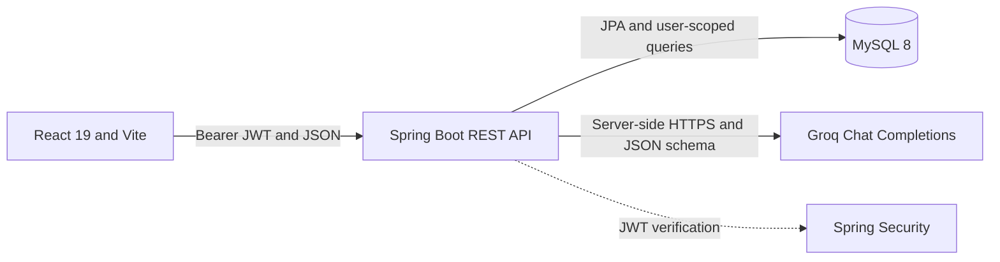

# HireForge AI

HireForge is a private job-search workspace for tracking applications and preparing for interviews. It combines a React dashboard with a JWT-protected Spring Boot API and Groq-powered career tools.

## Features

- Email/password registration and sign-in with BCrypt password hashing and signed JWTs.
- User-scoped application CRUD, status updates, filtering, and company/role search.
- Dashboard totals, pipeline distribution, response rate, interview rate, and offer rate.
- PDF resume analysis with role-aware strengths, weaknesses, skills not evidenced, ATS suggestions, and actionable edits.
- Resume/job-description matching with evidence-backed overlaps and missing keywords.
- Interview question generation and answer evaluation with constructive feedback and a sample answer.
- Responsive dashboard and career-tool screens, accessible form states, and clear API errors.

Career-tool requests are sent to Groq for processing. HireForge does not store resume text, job descriptions, or interview answers. The Groq key remains on the backend.

## Screenshots

Capture and add screenshots here after configuring a demo account and a running backend:

- `docs/screenshots/dashboard.png` — dashboard and application pipeline.
- `docs/screenshots/resume-review.png` — structured resume feedback.
- `docs/screenshots/interview-coach.png` — question practice and answer feedback.

## Architecture



The frontend never receives the Groq API key. AI tools do not write their submitted text or results into the application database. Existing application records remain linked to their owning user.

## Tech stack

| Area | Technology |
| --- | --- |
| Frontend | React 19, Vite, Lucide icons, responsive CSS |
| Backend | Java 21, Spring Boot 3.5, Spring MVC, Bean Validation |
| Authentication | Spring Security, JWT, BCrypt |
| Persistence | Spring Data JPA, MySQL 8, H2 for tests |
| Resume parsing | Apache PDFBox |
| AI | Groq OpenAI-compatible Chat Completions, default model `openai/gpt-oss-120b` |
| Deployment | Docker, Docker Compose, Nginx |

The configured Groq model is `openai/gpt-oss-120b`. Check Groq's current model and structured-output documentation before changing the configured model.

## Requirements

- Java 21
- MySQL 8 or compatible for local development
- Node.js 22.12+ (or 20.19+) and npm
- Docker Engine with the Docker Compose plugin for the containerized demo

## Local development

1. Create a MySQL database named `hireforge` (or configure `DB_URL`). Local mode uses `JPA_DDL_AUTO=update` to keep the existing local schema usable. Back up any database before changing schemas.
2. Set backend variables in the shell where the backend will run. Do not commit an actual `.env`, password, JWT secret, or Groq key. The backend does not automatically load `.env` files.

   PowerShell example:

   ```powershell
   $env:DB_URL = 'jdbc:mysql://localhost:3306/hireforge?useSSL=false&allowPublicKeyRetrieval=true&serverTimezone=UTC'
   $env:DB_USERNAME = 'your_mysql_user'
   $env:DB_PASSWORD = 'your_mysql_password'
   $env:JWT_SECRET = [Convert]::ToBase64String([Security.Cryptography.RandomNumberGenerator]::GetBytes(32))
   $env:CORS_ALLOWED_ORIGINS = 'http://localhost:5173'
   $env:GROQ_API_KEY = 'set-this-locally-from-your-Groq-console'
   $env:GROQ_MODEL = 'openai/gpt-oss-120b'
   ```

   Keep the shell open while running the backend. To run without a Groq key, omit `GROQ_API_KEY`; protected AI endpoints then return `503` with a configuration message, while account and application features remain available.

3. Start the backend:

   ```powershell
   cd backend
   .\mvnw.cmd spring-boot:run
   ```

4. In a second terminal, start the frontend:

   ```powershell
   cd frontend
   npm ci
   npm run dev
   ```

   Vite uses `http://localhost:8080/api` by default. To point it elsewhere, create `frontend/.env` from `frontend/.env.example` and set `VITE_API_URL`. This value is public frontend configuration; never place API keys in a `VITE_` variable.

## Environment variables

Copy the relevant placeholder file for reference: root `.env.example` for Docker Compose, `backend/.env.example` for the API, or `frontend/.env.example` for Vite. These files contain placeholders only and are committed intentionally. Replace placeholders in your local environment or hosting dashboard, never in source files.

| Variable | Used by | Purpose |
| --- | --- | --- |
| `DB_URL` | Backend | JDBC URL for MySQL |
| `DB_USERNAME`, `DB_PASSWORD` | Backend | MySQL credentials |
| `JPA_DDL_AUTO` | Backend | Local default is `update`; production profile uses `validate` |
| `JWT_SECRET` | Backend | Base64-encoded HMAC secret; generate at least 32 random bytes |
| `JWT_EXPIRATION_MS` | Backend | Optional JWT lifetime; defaults to 24 hours |
| `CORS_ALLOWED_ORIGINS` | Backend | Comma-separated exact frontend origins; no wildcard |
| `GROQ_API_KEY` | Backend only | Groq secret; never expose it to Vite or the browser |
| `GROQ_MODEL` | Backend | Defaults to `openai/gpt-oss-120b` |
| `GROQ_API_BASE_URL` | Backend | Defaults to `https://api.groq.com/openai/v1` |
| `GROQ_CONNECT_TIMEOUT_MS`, `GROQ_READ_TIMEOUT_MS` | Backend | Groq HTTP timeouts; defaults are 3000 and 45000 ms |
| `VITE_API_URL` | Frontend build | API base URL. Public, not a secret. |

## API endpoints

All routes except registration and login require `Authorization: Bearer <token>`.

| Method | Path | Request | Purpose |
| --- | --- | --- | --- |
| `POST` | `/api/auth/register` | `{name,email,password}` | Create account and return JWT |
| `POST` | `/api/auth/login` | `{email,password}` | Authenticate and return JWT |
| `GET` | `/api/applications` | — | List current user’s applications |
| `GET` | `/api/applications/{id}` | — | Read an owned application |
| `POST` | `/api/applications` | Company, role, status, optional date/notes/description | Create an application |
| `PUT` | `/api/applications/{id}` | Same application fields | Update an owned application |
| `DELETE` | `/api/applications/{id}` | — | Delete an owned application |
| `POST` | `/api/career/resume-analysis` | Multipart `file` PDF and `role` | Parse and analyze a resume |
| `POST` | `/api/career/job-match` | `{resumeText,jobDescription}` | Compare resume evidence to a role |
| `POST` | `/api/career/interview-prep` | `{role,company?,jobDescription?}` | Generate six practice questions |
| `POST` | `/api/career/interview-evaluate` | `{role,question,answer,company?}` | Evaluate an answer and suggest a truthful revision |

Career inputs are bounded by the API, PDF uploads are limited to 5 MB, and Groq rate limits are returned as HTTP `429` without exposing provider response bodies. AI scores are estimates and not hiring predictions.

## Database schema and data preservation

`backend/db/migration/V1__initial_schema.sql` defines the initial schema for a fresh database. Docker Compose applies it only when the MySQL data volume is initialized for the first time. The existing local database is not used by Compose unless you explicitly change its JDBC configuration.

Production runs with `SPRING_PROFILES_ACTIVE=prod` and Hibernate `validate`, which checks the schema without automatically altering it. For a new hosted database, apply the initial SQL once before starting the API. For an existing database, first take and verify a backup; do not apply the initial schema as a substitute for an upgrade plan. Write and review a versioned, additive SQL migration for any required schema change, apply it to a staging copy, then deploy with `validate`. Never assign unowned application rows to a user automatically.

## Docker Compose demo

Docker Compose starts MySQL, Spring Boot, and Nginx with a persistent database volume. It exposes the web app at `http://localhost:8081` and proxies `/api` to the backend on the private Compose network.

```powershell
Copy-Item .env.example .env
# Edit .env locally. Generate JWT_SECRET rather than using the placeholder.
docker compose up --build
```

The Compose MySQL service initializes the schema only for a new empty volume. It does not delete or migrate an existing external database. Keep `.env` private. To stop the demo without deleting database data, use `docker compose down`; do not add `--volumes` unless you intentionally want to remove the Compose database volume.

## Deployment status

The included Docker Compose setup is a local demo. No hosted deployment has been configured or verified, and this README does not recommend a specific cloud provider or claim current hosting prices or limits. Before deploying, choose a provider and verify its current build, networking, storage, and pricing requirements. Keep secrets in the provider's secret manager and set `SPRING_PROFILES_ACTIVE=prod`, `JPA_DDL_AUTO=validate`, and an exact `CORS_ALLOWED_ORIGINS` value for the deployed frontend.

## Tests and builds

From the repository root:

```powershell
cd frontend
npm ci
npm run lint
npm run build

cd ..\backend
.\mvnw.cmd clean package
```

Backend tests use H2 and mocked Groq HTTP responses; they do not require an API key. `clean package` includes test compilation and execution.

The commands above are instructions, not a report of successful runs. The backend Dockerfile builds with `-DskipTests`, so its image build does not run the test suite.
